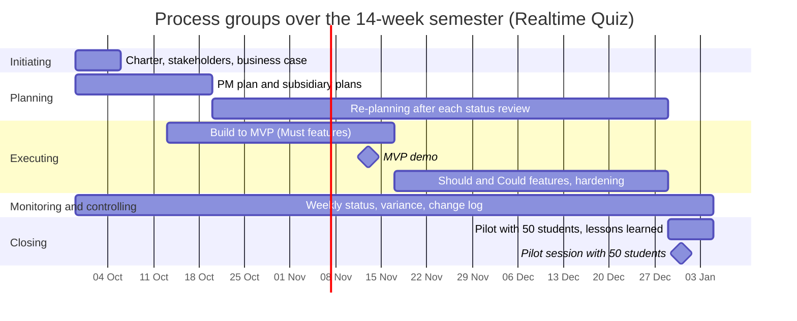

# Process groups over the semester

Week n starts on 2026-09-29 + 7 x (n - 1) days: week 1 = 29 Sep, week 3 = 13 Oct, week 4 = 20 Oct, week 7 = 10 Nov, week 8 = 17 Nov, week 13 = 22 Dec, week 14 = 29 Dec.

| Process group | Weeks active | Main activities | Outputs | Lab that produces them |
|---------------|--------------|-----------------|---------|------------------------|
| Initiating | 1 (and re-confirmed at the gates in weeks 7 and 13) | classify the work, write the charter, identify the sponsor, PM and stakeholders, justify the investment | project charter, stakeholder list, business case | Lab-01 (this lab) |
| Planning | 1-3 first burst; 4-13 continuing re-planning after each status review | scope, schedule, budget, risk and other plans; re-planning when the status review shows variance | project management plan, baselines, updated plans | Lab-02 onwards (the schedule with ProjectLibre in Lab-05; the stakeholder register in Lab-11) |
| Executing | 3-13 (build to MVP weeks 3-7; Should and Could features and hardening weeks 8-13) | build the ten phases, hold a short demo and a tagged commit at the end of each phase, run the load test | working platform, MVP demo, Should features, runbook | the build work of the capstone, with evidence in every lab |
| Monitoring and controlling | 1-14 | weekly status meeting, schedule and cost variance, risk review, change requests | status reports, change log, updated baselines | Labs 05, 06 and 09 (tools) and every lab (practice) |
| Closing | 14 (pilot week; hand-over preparation from week 13) | pilot with 50 students, hand-over to IT operations, lessons learned, final report | pilot report, hand-over, lessons learned | the final labs (closure) |

## Process groups over the semester

## Phase gates
The sponsor decides at three points whether to continue, change or stop the project. Each gate checks the continued business justification (the PRINCE2 idea): is the project still worth its cost and still achievable?

- **Week 1, charter approval.** Evidence: the signed charter with the five objectives and the 490 h and 200 USD budget, the stakeholder list with the sponsor and PM named, and the business case recommending option C. The sponsor decides to start, change the scope or stop.
- **Week 7, MVP demo.** Evidence: all 8 Must features pass a live demo with no blocking defect (O1), the hours and cash used against the baseline, and the updated risk list. If the demo fails, the sponsor applies the review gate of the business case and switches to buying a SaaS (option B) for next semester.
- **Week 13, pilot readiness.** Evidence: the load test with 100 simulated students is green (O3 and O4), the data approval has been received from the data protection officer, and the runbook is handed to IT operations. If any item is missing, the sponsor decides to postpone the pilot or to change its scope.
